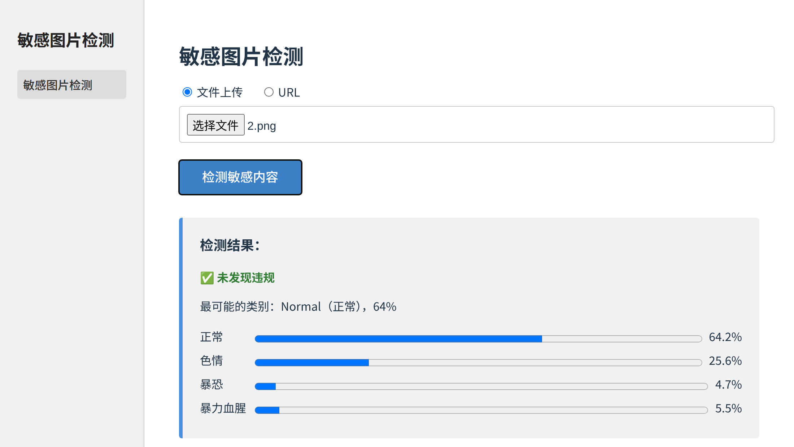

# clip-content-moderation

基于 OpenAI CLIP 的**零样本敏感图片检测**：不用训练、不用标注数据，靠“图片和文字描述有多像”判断一张图是正常、色情、暴恐还是暴力血腥。前端 Vue 3，后端 FastAPI，支持上传图片和图片 URL 两种方式。

Zero-shot image moderation with CLIP: no training data, just text prompts per category. Vue 3 front end, FastAPI back end, file upload or image URL.



## 原理

1. 每个类别写一组英文描述（`app/prompt_words.py`）：正常类 23 条日常场景，色情 / 暴恐 / 暴力各 5–8 条。
2. CLIP（ViT-B/32）把图片和所有描述编码到同一个向量空间，算余弦相似度。
3. 按 CLIP 自己的做法换成概率：相似度乘上模型的 `logit_scale`（约 100），对所有描述做 softmax，再把同一类别的描述概率加起来。
4. 概率最高的类别不是“正常”、且占比 ≥ 60% 时判为违规（`result: 1`）。

描述的编码在启动时只算一次，之后每次请求只需要编码图片，CPU 上一张图大约零点几秒。

## 这一版修了什么

第一版有两个问题，导致它其实**从来不会报违规**，页面也显示不出结果：

| 问题 | 原因 | 修法 |
| --- | --- | --- |
| 永远判为正常 | 拿原始余弦相似度 ×100 和 70 比；但 CLIP 的图文相似度对任何图都只有 0.15–0.35，实测 10 张图得分 16–26，永远到不了 70 | 改成 softmax 概率，按类别求和 |
| 普通图片被归到“色情” | 正常类只有 8 条描述，风景、文件页这类图哪条都不像，就被分到别的类（10 张正常图里 6 张最高类别是色情 / 暴恐 / 暴力） | 正常类扩到 23 条（食物、风景、文档、截图、卡通、产品图……） |
| 页面不显示结果 | 前端把整个响应 `{code, message, payload}` 当结果用 | 取 `payload`；并显示每个类别的概率条 |
| 暴力类没有中文名 | 前端标签表漏了 `Violence` | 补上 |
| URL 检测能访问服务器内网 | 后端会去下载任意地址（SSRF） | 只允许公网 http(s) 地址，不跟随跳转，限 10 MB |

修完后同样 10 张正常图片（照片、论文页、三维卡通截图）：**0 张误报**。但余量不大：4 张“正常”只有 50%–64%，还有 2 张（湖边栈桥、街头集市）最高类别仍是色情 / 暴恐，只是没到 60% 的线。

## 运行

```bash
# 后端（第一次会自动下载 CLIP 权重，约 350 MB）
pip install -r requirements.txt
uvicorn app.main:app --port 8000

# 前端
cd frontend
npm install
npm run dev            # 后端不在 localhost:8000 时：VITE_API_URL=http://host:port npm run dev
```

## 接口

`POST /upload-image`（表单字段 `file`）或 `POST /check-url`（JSON `{"url": "..."}`），返回：

```json
{"code": 200, "message": "检测成功",
 "payload": {"result": 0, "score": 96, "label": "Normal",
             "scores": {"Normal": 96.4, "Porn": 3.3, "Terrorism": 0.1, "Violence": 0.1}}}
```

## 局限

- 零样本方法适合做演示和初筛，**不适合直接用于生产审核**：结果很依赖描述怎么写，正常图的概率余量不大，阈值也只用少量正常图调过。
- 没有用违规样本做系统评估，所以召回率（能抓住多少真正违规的图）未知。真要上线，应在带标注的数据集上测准确率，或换专门训练的审核模型。
- 只看画面，不看图里的文字。
